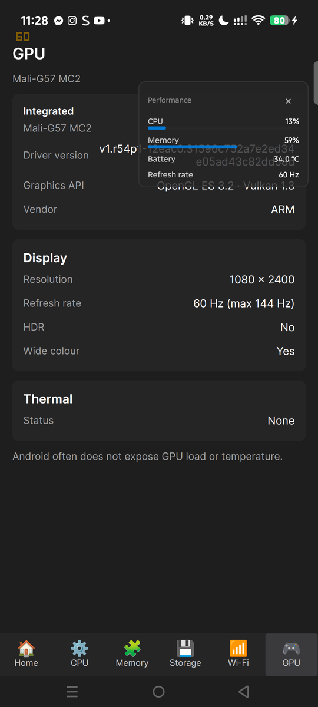
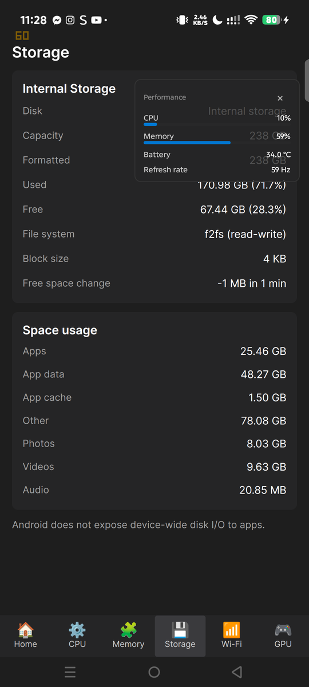
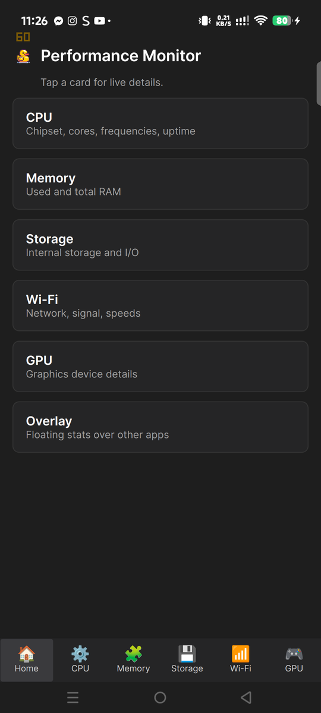
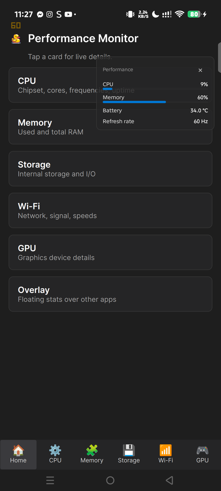
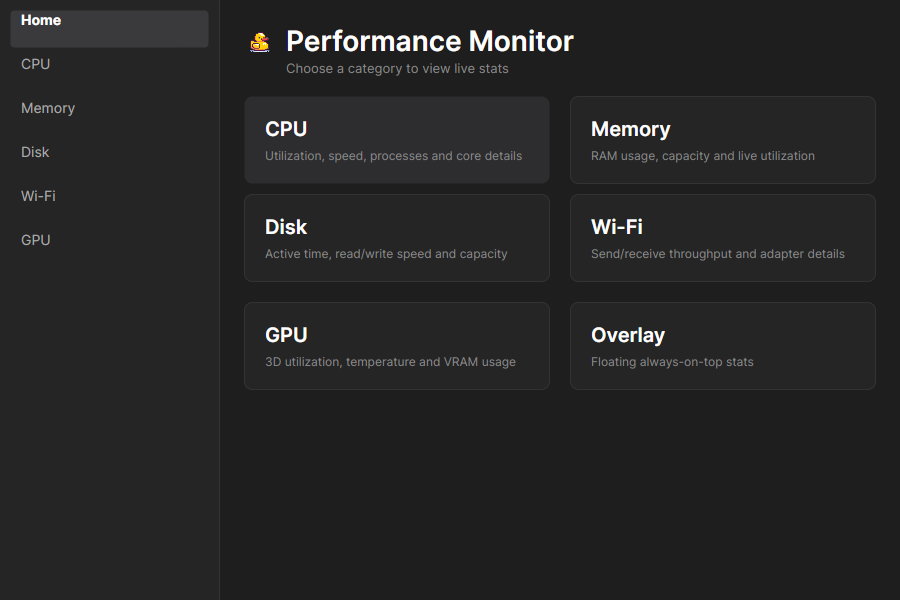

# Performance Monitor

A cross-platform hardware monitoring app for Windows, Linux, and Android. It reads real-time CPU, GPU, Memory, Disk, and WiFi data and displays it in a desktop-class interface.

**This is an educational / portfolio project.** It is not published to any app store, has no monetization, and is intended for personal use and learning.

---

## What it does

Performance Monitor reads hardware data through platform-specific APIs and shows it in one UI:

- **CPU** — name, cores, live utilization, per-core frequencies (Android), cache sizes (Windows/Linux)
- **GPU** — model, vendor, driver version, Graphics API (OpenGL ES / Vulkan), display resolution, refresh-rate mode, HDR and wide-colour support, thermal status, utilization and VRAM where the platform exposes them
- **Memory** — total, used, percentage, swap/ZRAM (Android)
- **Disk** — model, capacity, filesystem, block size, live read/write speed, extra volumes, and a space breakdown (apps, app data, app cache, photos, videos, audio, other) on Android
- **WiFi** — SSID, signal, standard, DHCP/gateway/DNS, live throughput
- **Overlay** — compact always-on-top panel (Android and Linux X11) with CPU, memory, battery, and refresh rate

The app **never fakes data**. If a platform blocks access to a value (for example, Android blocks system-wide CPU utilization since Android 8), the app hides the row or shows an honest reason rather than a wrong number.

---

## Screenshots

| Android — GPU | Android — Storage |
|:--:|:--:|
|  |  |

| Android — Home | Android — Overlay |
|:--:|:--:|
|  |  |



---

## Install

Download the latest files from [Releases](https://github.com/niljbacq/performancemonitor/releases/latest). Every download is the app itself — no zip, no extraction.

### Windows

1. Download `PerformanceMonitor-Windows.exe`.
2. Run it.
3. If Windows SmartScreen shows "Windows protected your PC", click **More info → Run anyway**. The binary is unsigned.

### Linux

- **Ubuntu / Debian:** download `PerformanceMonitor-Linux.deb`, open it, and install. The app then appears in your applications menu.
- **Portable:** download `PerformanceMonitor-Linux`, make it executable once, and run it:
  ```bash
  chmod +x PerformanceMonitor-Linux
  ./PerformanceMonitor-Linux
  ```

No extra GPU tool is required: Radeon utilization is read directly through the kernel DRM interface, without `sudo`.

Use the **Overlay** card on Home for a compact always-on-top panel. Linux X11 supports this; Wayland compositors may ignore the always-on-top hint. On Android, the card requests “Display over other apps” and opens a floating overlay that keeps updating in the background. The FPS row is the desktop overlay's render rate, not a game's FPS; game FPS needs a graphics-API hook.

### Android

1. Download `PerformanceMonitor-Android.apk`.
2. Open the file and allow installation from this source when Android asks.
3. Open **Performance Monitor** from your app list.

Two permissions are optional and only used by the Storage tab:

- **Usage access** — shows the Apps, App data, and App cache rows. The tab offers an **Open settings** button; without it those rows stay hidden instead of showing guesses.
- **Photos, videos, and audio** — requested only when you tap **Allow media access**, never at startup. Granting adds the Photos, Videos, and Audio rows; denying (or Android 14's "Select photos") simply leaves those bytes inside Other.
